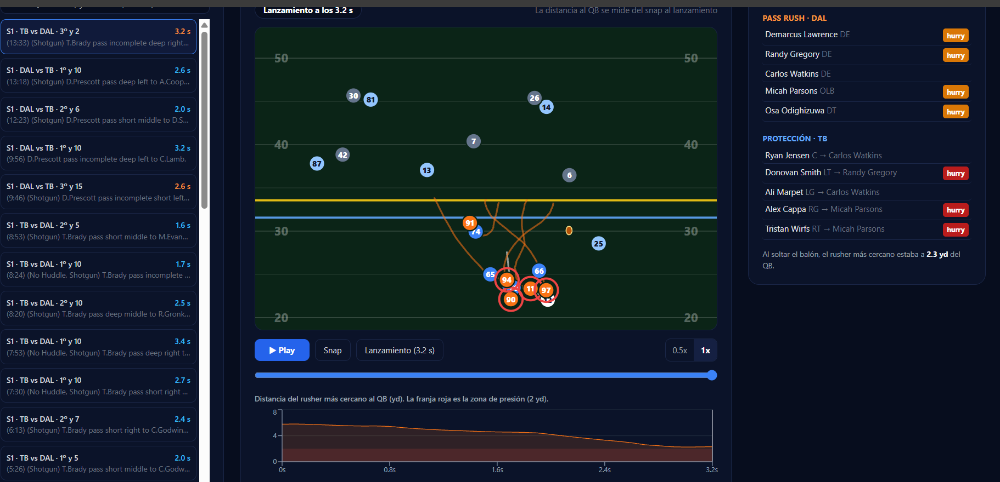
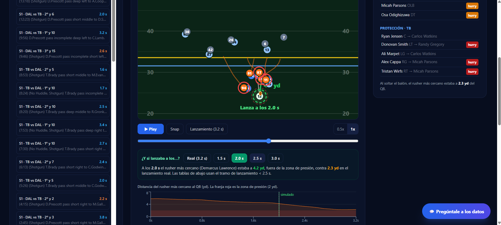

# NFL Pressure Lab

NFL Pressure Lab es un dashboard que analiza la presión sobre el quarterback con datos de PFF y tracking de la NFL (temporada 2021, semanas 1 a 8). Permite revisar cada jugada en un campo 2D animado y simular qué habría pasado si la defensa enviaba otro número de rushers o el QB tardaba otro tiempo en lanzar. A diferencia de los dashboards que solo cuentan sacks o presiones, mide cuándo y qué tan cerca llega la presión, y separa la que permite la línea ofensiva de la que provoca el propio QB al retener el balón. Su hallazgo principal es que la presión le cuesta al QB 2.0 yardas por intento en promedio, pero ese costo pasa de 0.9 yardas si lanza en menos de 2.5 s a 4.0 yardas si retiene el balón más de 3.5 s. Está pensado para coordinadores ofensivos y defensivos, coaches de línea y analistas de rendimiento que preparan planes de juego o evalúan jugadores.

*Simulador de presión, TB contra DAL, 3.º y 2. Los círculos rojos marcan a los rushers que generaron presión. La gráfica inferior muestra cómo se cierra la distancia entre el rusher más cercano y el QB hasta el lanzamiento, a los 3.2 s.*

*La misma jugada en modo "¿Y si lanzaba a los…?". Si Brady lanzaba a los 2.0 s, el rusher más cercano (Demarcus Lawrence) estaba a 4.2 yd, fuera de la zona de presión, contra 2.3 yd en el lanzamiento real. El simulador recalcula el resultado para ese tramo, y el botón "Pregúntale a los datos" abre el asistente con preguntas rápidas e IA.*
